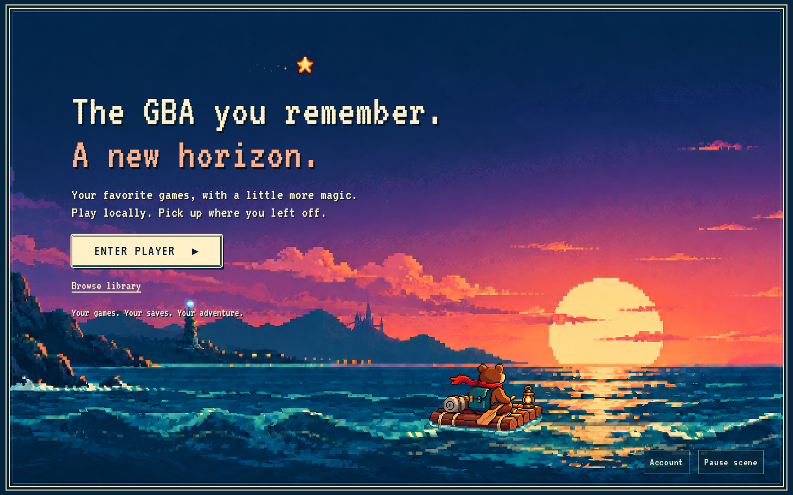

# Evenfall

[](https://github.com/evenfall-emu/evenfall/actions/workflows/ci.yml)
[](LICENSE)

Evenfall builds retro console emulators from scratch, in Rust, for every platform: native, the browser, and later mobile.
It starts with the Game Boy Advance, with more consoles to come.
Its player is made for rediscovering games and their ROM hacks.



**[Play at play.evenfall-emu.org](https://play.evenfall-emu.org)**.
The emulator runs in your browser, and your games never leave your device.

> Evenfall doesn't include games, and boots them with its own BIOS, so you don't need a BIOS file.
> Bring your own legally obtained games.
> Evenfall is not affiliated with or endorsed by Nintendo.

## Why Evenfall

**Exact.** Every instruction fetch pays its wait states, DMA and timers interleave with the CPU where the hardware does, every frame is fully drawn and sound is emulated sample by sample.
A raster effect written in the middle of a line changes the picture from the pixel it lands on.

**Deterministic.** The same ROM and inputs give the same pixels, sound and saves, natively or in the browser, however the work is sliced.
Save states and rewind are exact, and a bug report can be a file that reproduces the bug anywhere.

**Very fkin fast.** Native, on one core, it runs 60 to 200 times faster than real time on ROMs built to stress one expensive path each, and idle frames cost almost nothing.
That is two to three times as fast as other mainstream emulators on stress-test ROMs, and even more on commercial games.
Every fast path is tested against a simple reference and must give exactly the same result.
[How it's fast](docs/performance.md).

**Rewinds a long way back.** Rewind keeps a compact history in a fixed memory budget: a checkpoint every second or so for the last minutes, thinning with age, up to several days of play at a few minutes apart.
[How rewind works](docs/design/rewind.md).

**Lets your UI read the game.** Game bridges decode live memory into typed data, such as your party or the current map, for trackers, dashboards and stream overlays in TypeScript or React.
[Game bridges](docs/game-bridges.md).

**A library first.** The core has no I/O of its own.
The same code runs the command-line runner and the JavaScript SDK.

## Status

The Game Boy Advance core covers the whole console: ARM and Thumb, every video mode and effect, both kinds of sound, DMA, timers, every save chip, the real-time clock and cartridge sensors, and link cables including MultiBoot.
It boots games through its own BIOS, or with a real one.

It passes every [jsmolka/gba-tests](https://github.com/jsmolka/gba-tests) ROM and every probe ROM written for the project, each checked against values from hardware documentation, not from Evenfall itself.
Compatibility across commercial games and ROM hacks hasn't been audited broadly yet.
[Status](docs/status.md) and [compatibility](docs/compatibility.md) have the details.

## Get it

Evenfall hasn't tagged a release yet, so for now, build it from source.
You need Rust (the version in `rust-toolchain.toml` installs itself through `rustup`), and Node.js 24.11 or later for the browser build.

```sh
git clone https://github.com/evenfall-emu/evenfall && cd evenfall
cargo test --workspace
cargo run --release -p evenfall-gba -- run --steps 5000000 --frame-hash --quiet game.gba
npm ci && npm run build:wasm -w @evenfall/gba && npm test
```

The [command-line guide](docs/cli.md) covers saves, cartridge hardware, traces and input movies, and the [testing guide](docs/testing.md) covers every test.

## Build with it

| To build                    | Use                                                    | Guide                                          |
| --------------------------- | ------------------------------------------------------ | ---------------------------------------------- |
| a web app                   | `@evenfall/gba`, an SDK that runs the core in a Worker | [SDK](docs/sdk.md)                             |
| a Node tool or test harness | `@evenfall/gba/core` and the developer tools           | [SDK: Node](docs/sdk.md#node-and-headless-use) |
| a UI around a running game  | typed game bridges, with React bindings                | [Game bridges](docs/game-bridges.md)           |
| a native Rust program       | the `evenfall-gba` crate                               | [Architecture](docs/architecture.md)           |

## How it's built

```text
 CLI · WebAssembly + JS SDK · your app
                 │
              Session      host policy: pacing, audio, rewind
                 │
              Machine      the console: deterministic, no I/O
               │     │
             CPU     Bus ── video · sound · timers · DMA · cartridge · link
```

[Architecture](docs/architecture.md) explains the layers and how time flows through them, and the [hardware reference](docs/gba/hardware/README.md) explains how the GBA works and how Evenfall models it.
The [docs index](docs/README.md) has the rest.

| Path          | Contents                                                          |
| ------------- | ----------------------------------------------------------------- |
| `crates/`     | code shared by every console: state codec, ARM CPU, audio, replay |
| `systems/gba` | the Game Boy Advance core and its command-line runner             |
| `web/gba`     | the WebAssembly module and the `@evenfall/gba` SDK                |
| `probe/`      | bare-metal test ROMs                                              |
| `tools/`      | benchmarks and test tools                                         |
| `docs/`       | documentation                                                     |

## Acknowledgements

Evenfall stands on the work of people who documented and emulated the GBA long before it:

- [GBATEK](https://problemkaputt.de/gbatek.htm) by Martin Korth, read through its [GBA-only edition](https://github.com/rust-console/gbatek-gbaonly).
- [mGBA](https://mgba.io/) by Vicki Pfau and contributors, and its [test suite](https://github.com/mgba-emu/suite), whose recorded hardware results are reproduced here as tests.
- [NanoBoyAdvance](https://github.com/nba-emu/NanoBoyAdvance) by fleroviux and contributors, for timing, prefetch and rendering details.
- [jsmolka/gba-tests](https://github.com/jsmolka/gba-tests) by Julian Smolka, whose ROMs gate every change and whose reporting convention the probe ROMs follow.
- The [Cult-of-GBA BIOS](https://github.com/Cult-of-GBA/BIOS), an open replacement BIOS used to test real-BIOS boot, and Arm's ARM7TDMI manuals.

All of Evenfall's code is original: these projects were studied and compared against, never copied.
Pinned revisions are listed in [`refs/README.md`](refs/README.md).

## Contributing

Contributions are welcome.
Start with [CONTRIBUTING.md](CONTRIBUTING.md) and the [Code of Conduct](CODE_OF_CONDUCT.md), and report security issues as described in [SECURITY.md](SECURITY.md).

## License

Evenfall is free software under the [GNU Affero General Public License](LICENSE), version 3 or (at your option) any later version.
Copyright © 2026 Martin Conraux and the Evenfall contributors.

You may use, study, change and share it.
Anything built on it that you distribute, or let people use over a network, must be released under the same license with its full source.
For other terms, contact [contact@evenfall-emu.org](mailto:contact@evenfall-emu.org).

As an additional term under section 7(e) of the license, the Evenfall name and logos are not licensed, so forks and derived products must use a different name.
